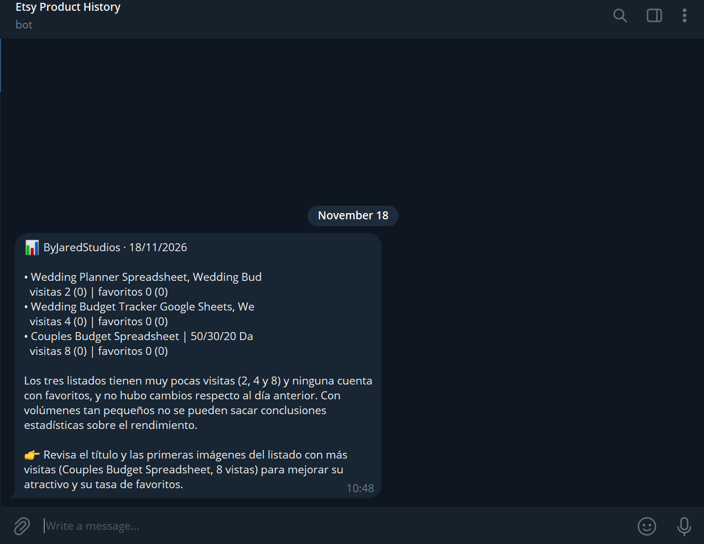
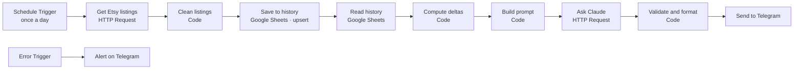

# 01 · Daily Shop Digest

An n8n workflow that reads the stats of my own Etsy shop every day, stores them in Google Sheets, compares them with the previous recorded day and sends me a short summary on Telegram. A second workflow alerts me if anything fails.

I built it for my own shop (digital Google Sheets templates), so it solves a real problem: Etsy only shows today's numbers, and I wanted a history without checking the dashboard by hand.



## How it works



1. **Get Etsy listings:** calls the Etsy Open API v3 for the active listings of my shop.
2. **Clean listings:** keeps only the fields I need (views, favorites, price, auto-renew) and builds a unique key per day and listing.
3. **Save to history:** appends or updates a row in Google Sheets. Matching on the key makes the workflow idempotent: running it twice on the same day never creates duplicates.
4. **Compute deltas:** compares today with the latest earlier date recorded for each listing (not "yesterday", so a missed day does not break it).
5. **Ask Claude:** the model writes a short summary, an optional alert and one suggested action, returned as JSON.
6. **Validate and format:** parses the JSON, falls back to a plain summary if it is malformed, and builds the final message.
7. **Send to Telegram:** delivers the message.

A separate workflow (`00 - Error Alert`) uses an Error Trigger to notify me on Telegram with the failing node and the error message.

## Design decisions

- **The model never produces the numbers.** Views, favorites and deltas are computed in code and inserted into the message. Claude only writes the interpretation, so it cannot invent a figure.
- **Graceful degradation.** If the model returns invalid JSON or the call fails after retries, the message still goes out with the raw numbers.
- **Idempotent writes.** One row per day and listing, keyed as `YYYY-MM-DD_listing_id`.
- **Small-data prompt rules.** The system prompt tells the model not to draw conclusions from a handful of views, which is the reality of a new shop.
- **Secrets stay out of the workflow.** All keys live in n8n credentials and a local `.env` that is git-ignored.

## Stack

n8n (self-hosted with Docker) · Etsy Open API v3 · Anthropic Claude API (`claude-haiku-5-5`) · Google Sheets API · Telegram Bot API · JavaScript (Code nodes)

## Setup

### 1. Run n8n

```bash
docker volume create n8n_data
docker run -d --restart unless-stopped --name n8n -p 5678:5678 \
  -e GENERIC_TIMEZONE="Europe/Madrid" -e TZ="Europe/Madrid" \
  -v n8n_data:/home/node/.n8n docker.n8n.io/n8nio/n8n
```

Then open `http://localhost:5678`. Use your own time zone.

### 2. Create the credentials in n8n

| Credential name | Type | Value |
| --- | --- | --- |
| `Etsy API` | Header Auth | Name `x-api-key`, value `KEYSTRING:SHARED_SECRET` |
| `Anthropic API` | Header Auth | Name `x-api-key`, value your Anthropic API key |
| `Google Sheets` | Google Sheets OAuth2 API | Client ID and secret from your Google Cloud project |
| `Telegram Bot` | Telegram API | Token from @BotFather |

- Etsy: register a **Seller App** at the Etsy Developer Portal (own shop, approved automatically). Since February 2026 the `x-api-key` header must contain the keystring and the shared secret joined by a colon.
- Anthropic: create a key in the Claude Console and add prepaid credits.
- Google: enable the Sheets and Drive APIs and publish the OAuth app, otherwise the token expires every 7 days.

### 3. Create the Google Sheet

Create a spreadsheet with a tab named `history` and these headers in row 1:

```
key | date | listing_id | title | views | favorites | price | currency | auto_renew
```

### 4. Import the workflows

1. Import `flows/00-error-alert/workflow.json` first.
2. Import `flows/01-daily-shop-digest/workflow.json`.
3. In the main workflow, go to **Settings → Error workflow** and select `00 - Error Alert`.
4. Reselect each credential in the nodes that show a warning.

### 5. Replace the placeholders

| Placeholder | Where to find it |
| --- | --- |
| `YOUR_SHOP_ID` | `GET /v3/application/shops?shop_name=YourShopName` |
| `YOUR_SPREADSHEET_ID` | The long ID in the Google Sheet URL (or reselect the document in the node) |
| `YOUR_TELEGRAM_CHAT_ID` | `https://api.telegram.org/bot<TOKEN>/getUpdates` after messaging your bot |

### 6. Schedule and publish

Set the Schedule Trigger to the time you want (the computer or server running n8n must be on at that time) and publish the workflow.

## Limitations and next steps

- **v1 uses only public listing fields** (views, favorites, price, renewal status). Sales and revenue need Etsy OAuth with PKCE, which is planned for v2.
- n8n runs locally, so no data is collected on days when the machine is off. Moving it to a small server would remove that gap.
- The Error Alert workflow fires only on automatic executions, not on manual test runs.